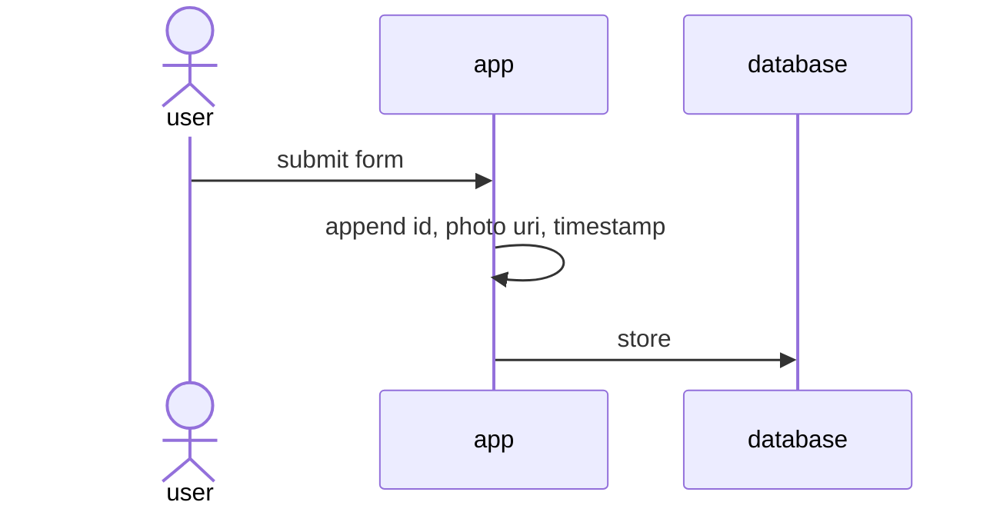

# Trackside

Trackside is a local-first trainspotting journal for UK rail enthusiasts, built
with React Native, Expo, and TypeScript.

### Mission

Trackside is an app for trainspotters, by trainspotters. Use of the app should be natural and fast,
to accomodate the "in the moment" nature of trainspotting.

## MVP

- Log a 4–6 digit TOPS number, with its class derived automatically.
- Optionally add a location, destination, and photo from the camera or library.
- Browse and remove recent sightings, with basic local collection stats.
- Store sightings in an on-device SQLite database; photos are copied into the
  app's local document storage.
- Run `npm run typecheck` to type-check the app.

No account, location permission, or network connection is needed. Following
other spotters and sharing or liking sightings are future features; nothing in
this MVP is uploaded or shared.

## Tests

```sh
npm test
npm run test:coverage
npm run typecheck
```

The Jest suites use Jest Expo and React Native Testing Library. Native image,
filesystem, alert, and database-context APIs are mocked at the component-test
boundary; SQLite wrapper unit tests separately verify SQL and bound values.
Coverage thresholds are enforced at 100% for statements, branches, functions,
and lines.

### E2E

E2E tests have been written using Maestro. These can be run against an Android emulator. To run these tests, take the following steps:

- Ensure Android emulator is running
- Run `npm run android`
- Run `npm run test:e2e`
- Hope that nothing fails

This will create a `reports` repo with a html report generated for the run.

## Android Builds

Create a local APK or app bundle with EAS:

```sh
npm run build:apk
npm run build:aab
```

`build:apk` uses the `preview` profile and produces an APK. `build:aab` uses the
`production` profile and produces an Android App Bundle. Both commands generate
the app icon PNGs from `assets/logo.svg` before EAS archives the project.

Local Android builds require the Android SDK and JDK 17. On Linux, select JDK 17
before running either command; update the path if JDK 17 is installed elsewhere:

```sh
export JAVA_HOME=/usr/lib/jvm/java-17-openjdk-amd64
export PATH="$JAVA_HOME/bin:$PATH"
```

The real SQLite integration suite runs in the app on a device or simulator
against an isolated `:memory:` database. Build and launch the integration
screen, then run its Maestro flow:

```sh
EXPO_PUBLIC_SQLITE_INTEGRATION=1 npx expo run:android
maestro test maestro/sqlite-integration.yaml
```

Use `npx expo run:ios` on macOS for iOS. For the normal app persistence journey,
run the app without the integration flag and execute:

```sh
npx expo run:android
maestro test maestro/local-journal-e2e.yaml
```

## Architecture

The user interacts with the app purely locally, to allow the fast interactions required, regardless of internet connectivity. This interaction consists of reads and writes to the local SQLite database.

